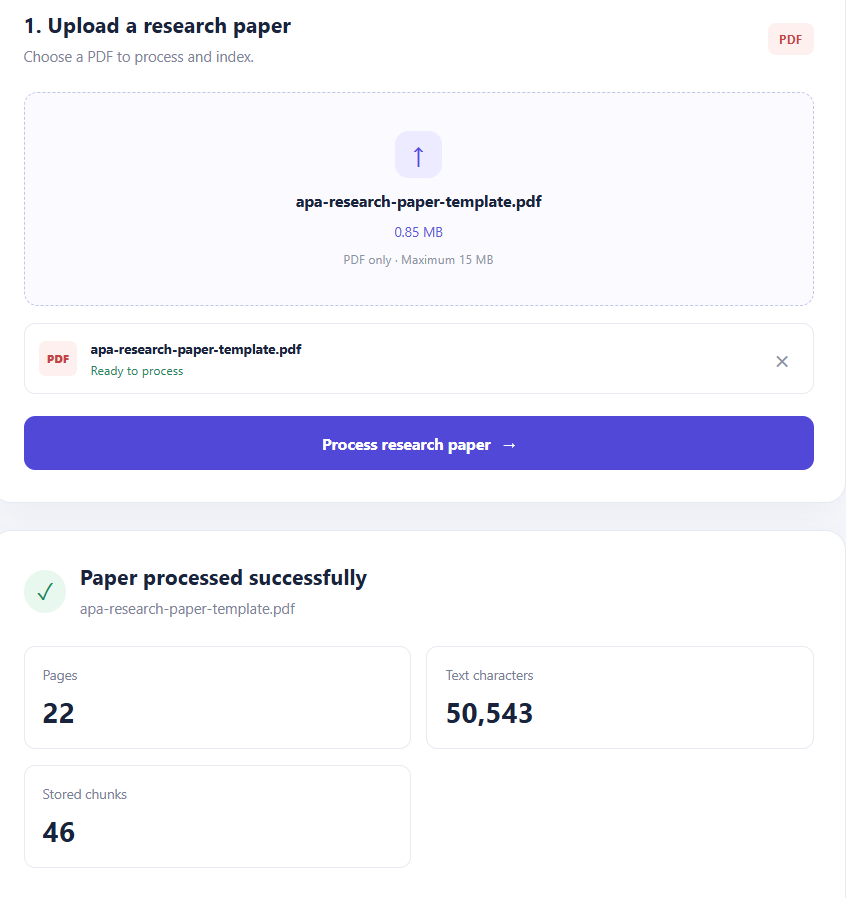
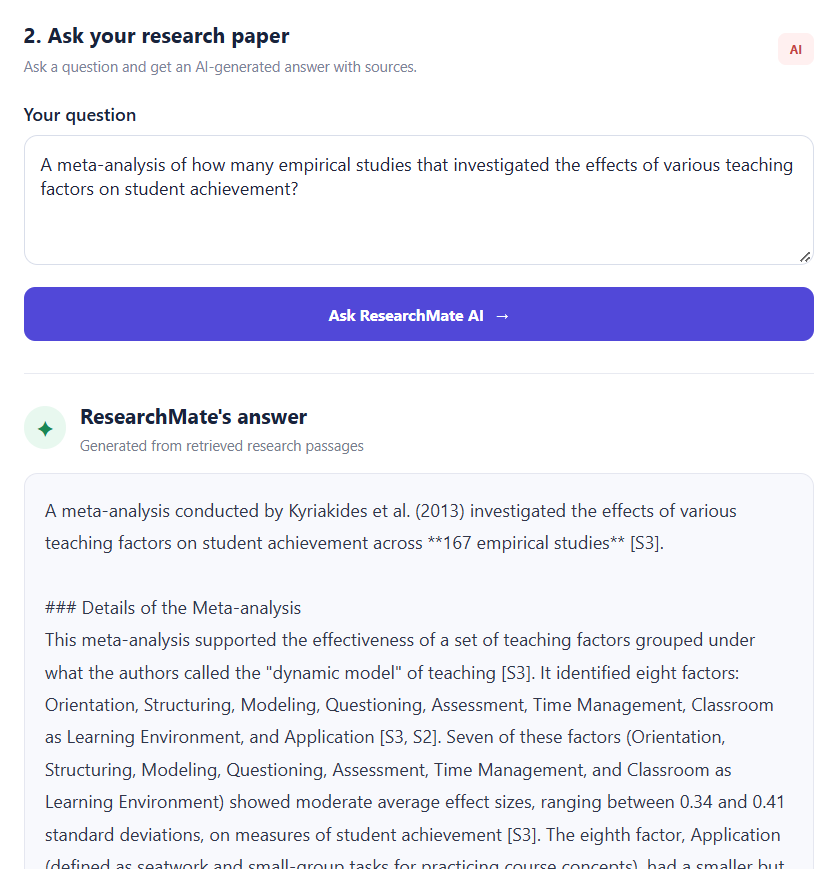
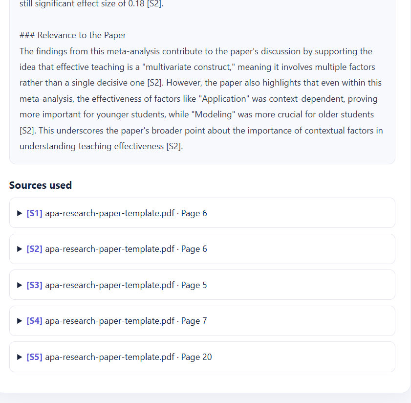

# ResearchMate AI 📚🤖

**An AI-powered research assistant that helps you understand research papers and get answers from their content.**

ResearchMate AI allows users to upload a PDF research paper and ask questions about it. It retrieves relevant information from the document and uses Google's Gemini API to generate answers, making research papers easier to explore and understand.

🔗 **Live Demo:** https://research-mate-ai-psi.vercel.app/  
💻 **GitHub Repository:** https://github.com/prachidoshi7/ResearchMate-AI

## 📸 Screenshots

### Application Interface


### AI-Generated Answer





## ✨ Features

- 📄 **PDF Upload:** Upload research papers for analysis.
- 🔍 **Semantic Search:** Retrieve relevant document chunks based on the meaning of a question.
- 💬 **AI-Powered Q&A:** Ask questions about the uploaded research paper and receive contextual answers.
- 🧠 **Vector Embeddings:** Convert document chunks and queries into embeddings for semantic retrieval.
- ⚡ **FastAPI Backend:** Handle document processing, retrieval, and AI-generated responses through API endpoints.
- ☁️ **Cloud Deployment:** Access the application through a live web interface.

## 🛠️ Tech Stack

| Component | Technology |
|---|---|
| Frontend | React, Vite, JavaScript |
| Backend | Python, FastAPI |
| AI Model & Embeddings | Google Gemini API |
| Database & Vector Storage | Supabase |
| Frontend Deployment | Vercel |
| Backend Deployment | Render |
| Version Control | Git, GitHub |

## 🏗️ System Architecture

1. **Upload:** The user uploads a PDF research paper.
2. **Processing:** The backend extracts text and splits it into smaller chunks.
3. **Embedding:** Gemini generates vector embeddings for the document chunks.
4. **Storage:** The chunks and their embeddings are stored in Supabase.
5. **Retrieval:** The user's question is embedded and used to retrieve relevant chunks through semantic search.
6. **Generation:** Gemini uses the retrieved context to generate a relevant answer.
7. **Response:** The answer is returned to the React frontend.

## 🚀 Getting Started

### Prerequisites

- Python
- Node.js and npm
- A Google Gemini API key
- A Supabase project

### 1. Clone the repository

```bash
git clone https://github.com/prachidoshi7/ResearchMate-AI.git
cd ResearchMate-AI
```

### 2. Configure the backend

```bash
cd backend
pip install -r requirements.txt
```

Create a `.env` file inside the `backend` directory and configure your credentials:

```env
GEMINI_API_KEY=your_gemini_api_key
SUPABASE_URL=your_supabase_project_url
SUPABASE_SECRET_KEY=your_supabase_secret_key
```

Replace the example values with your own credentials. Ensure your Supabase database table and vector search function are configured as required by the application.

Start the backend using the command appropriate for your FastAPI application. For example, if your entry point is `main.py`:

```bash
uvicorn main:app --reload
```

Backend API documentation is available at `http://localhost:8000/docs` when the local server is running on the default port.

### 3. Configure the frontend

Open a new terminal from the repository root:

```bash
cd frontend
npm install
```

Create a `.env` file inside `frontend`:

```env
VITE_API_BASE_URL=http://localhost:8000
```

Start the frontend:

```bash
npm run dev
```

Open the local URL displayed by Vite in your terminal.

## 🔐 Security

- Never commit API keys or database secrets to GitHub.
- Keep backend credentials in environment variables.
- Configure CORS to allow only the frontend origins required by your application.
- Do not expose Supabase secret keys through frontend environment variables.

## 🎯 Project Objective

The goal of ResearchMate AI is to simplify research paper exploration by combining document processing, semantic retrieval, vector search, and large language models in a single application.

## 👩‍💻 Developer

**Prachi Doshi**

Computer Science Engineering — AI & ML

GitHub: [@prachidoshi7](https://github.com/prachidoshi7)

---

*Built to make research more accessible, interactive, and efficient.*